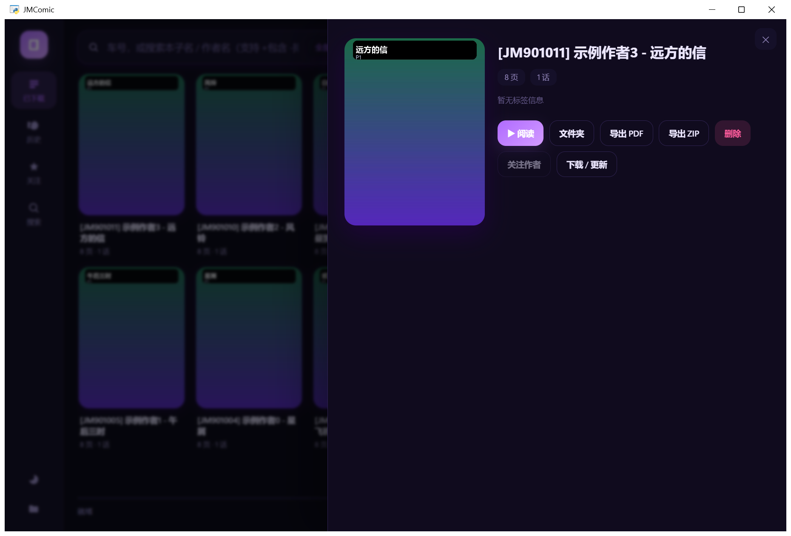
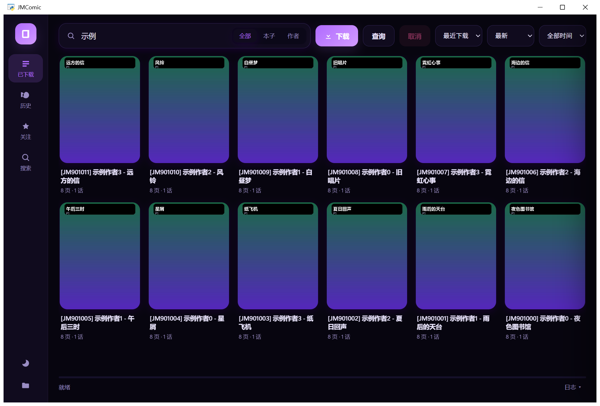
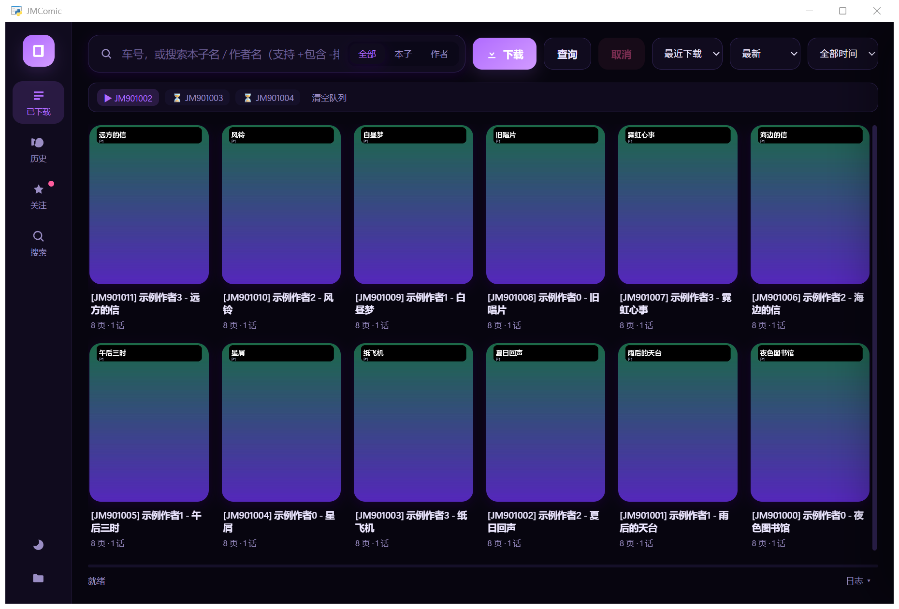
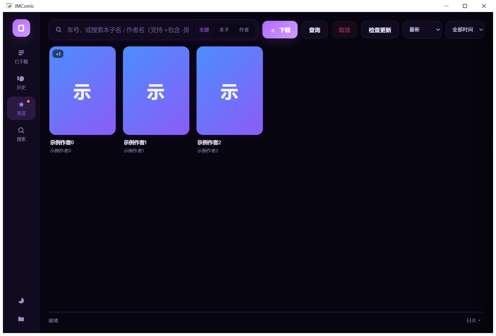
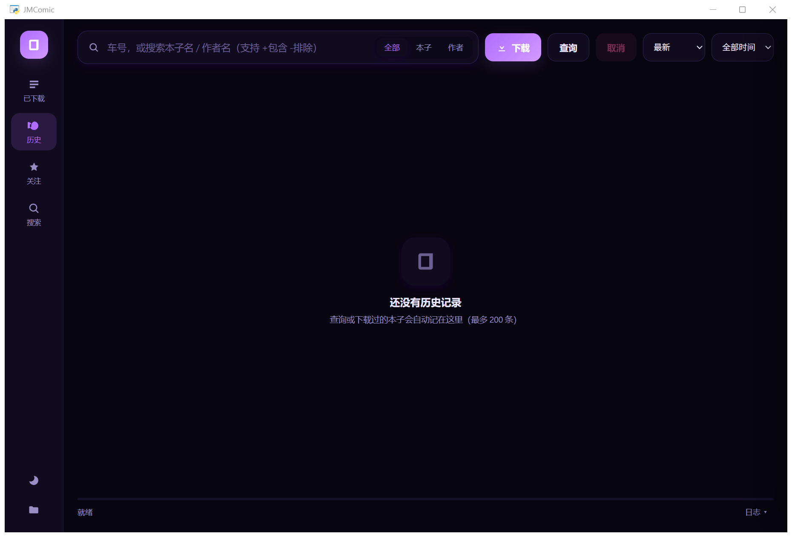
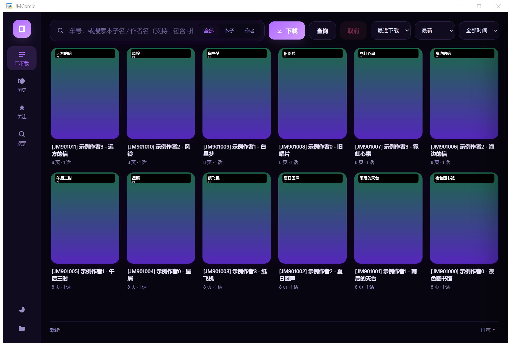

# 功能详解


> 本文把每个功能都配上实际界面截图，方便快速了解这套工具能做什么。
> 所有截图均使用自动生成的**演示书库**（12 本渐变封面），不含任何真实内容。

**一句话定位**：把「找本子 → 下载 → 整理 → 阅读 → 追更」这条链路做成一个本地桌面工具。

---

## 0. 整体结构

```
左侧导航            顶部搜索 / 操作区                     右侧内容区
┌──────┐  ┌──────────────────────────────────────┐  ┌──────────────────────┐
│ 已下载 │  │ 输入框 │ 全部·本子·作者 │ 下载 查询 取消 │  │ 封面墙 / 列表         │
│ 历史   │  │ 排序下拉 │ 时间下拉 │ 检查更新        │  │ 点击卡片 → 详情抽屉    │
│ 关注   │  └──────────────────────────────────────┘  └──────────────────────┘
│ 搜索   │  底部：进度条 + 状态文字 + 日志抽屉
└──────┘
```

---

## 1. 已下载库（主界面）


- **封面墙**：按目录扫描本地库，自动解析出 `[JM车号] 作者 - 标题`、页数、章节数
- **卡片信息**：`页数 · 话数 · 作者`；右上角还有阅读进度徽章（如 `12/55`）
- **双击卡片** = 直接**继续上次阅读**
- **单击卡片** = 打开详情抽屉（见第 2 节）
- 底部状态栏显示：`已下载 N 项 · 本子数 / 图片数 / 占用 MB`

### 筛选与排序

- 顶部输入框在「已下载」页就是**本地筛选**（按标题 / 作者 / 标签，输入即筛）
- 排序下拉：**最近下载 / 按名称 / 按页数 / 按话数 / 按作者 / 未读优先**
- 每个视图**各自记住自己的搜索词**，切换页面互不干扰

---

## 2. 详情抽屉



点击任意卡片后从右侧滑出，包含：

| 区域 | 内容 |
|---|---|
| 顶部 | 封面 + 标题 + 车号 |
| 胶囊标签 | 车号、作者、页数、话数 |
| 标签云 | 全部分类标签（每个标签独立胶囊） |
| 简介 | 有简介时显示，可滚动 |
| 动作按钮 | **阅读** / 打开文件夹 / 导出 PDF / 导出 ZIP / **关注作者** / **下载·更新** / **删除**（进回收站） |

> 搜索结果里的条目也一样：没补全的字段会在打开时用详情接口补一次。

---

> ⚠️ 搜索与下载需要**能访问目标站点**的网络（通常需要代理/VPN），详见 [docs/网络与代理.md](docs/网络与代理.md)。

## 3. 搜索



### 支持的输入格式

| 输入 | 行为 |
|---|---|
| `350234` | 直接按车号下载 |
| `p350240` | 解析成章节，下载其所在整本 |
| `https://…/album/350234` | 提取车号下载 |
| `【JM1481515】标题` | 从文字中提取车号 |
| `123 p456` | 多个目标一起入队 |
| `作者名` / `本子名` | **自动转成关键词搜索**，结果列出后可挑一本下载 |

> 文字里的 4 位年份（如 `2024`）不会被误判成车号。

### 官方排序 + 时间范围

- **排序**：最新 / 最多观看 / 最多点赞 / 最多图片 / 最高评分 / 最多评论
- **时间**：全部 / 今天 / 本周 / 本月
- 切换后**自动用上次关键词重搜**，无需重新输入

### 结果卡片

搜索结果先**秒出**（标题 + 作者），随后后台**分批补全**页数 / 话数 / 作者，
状态栏显示 `补全 6/20`；补全失败的条目点开时再试一次。

---

## 4. 下载：提取 → 排队 → 进度



- 顶部出现**队列条**：`▶ 当前任务 ⏳ 等待N个 [清空队列]`
- 连续提交多个车号会**自动排队串行执行**，不再"上一个没完就拒收"
- 进度条 + 状态文字实时更新；「取消」只终止当前任务，队列继续
- 已存在的图片**自动跳过**（断点续传天然支持）
- 下载命名规则（可在 `option.yml` 改）：

```
BaseDir/
  [JM350234] 作者 - 标题/
    001-第1話/
      JM350234_1.webp
      JM350234_2.webp
      …
```

---

## 5. 阅读器


| 能力 | 说明 |
|---|---|
| 三种模式 | **单页 / 双页 / 滚动**（工具栏按钮循环切换） |
| 三种适配 | 适应窗口 / **适应宽度**（长条图）/ 适应高度（横向图） |
| 缩放 | `Ctrl+滚轮` 或 `+/-`，**以鼠标位置为锚点**缩放 |
| 翻页 | `←/→`、`空格`、滚轮；双页模式一次走 2 页 |
| 快捷键 | `0` 适应、`Esc` 返回、`Home/End` 首末页 |
| 进度记忆 | 每本记录看到第几页，下次打开/双击卡片自动续读 |
| 主题 | 阅读界面有独立明暗切换 |

---

## 6. 追更（关注作者）



- 关注的是**作者**，不是单本作品
- 详情抽屉 →「关注作者」；已关注时按钮变为**「取消关注作者」**（带确认弹窗）
- 「检查更新」逐位作者查询其作品，与已知集合比对，**新作品打 `+N` 徽章**
- **导航红点**：有更新时「关注」图标右上角出现红点，悬停显示数量
- **启动自动检查**：距上次检查超过 2 小时，启动 4 秒后后台检查一次并弹提示
- 点作者卡片 → 直接列出该作者全部作品，挑一本下载

---

## 7. 历史



- **查询**和**下载**都会自动记录（同样的本子再下载会升级为"下载"标记，不重复）
- 最多保留 200 条，按时间倒序
- 空状态会按视图给不同提示（历史 / 关注 / 搜索 / 已下载 各不相同）

---

## 8. 主题

| 浅色 | 霓虹 |
|---|---|
|  |  |

- 5 套主题：**深色 / 浅色 / 霓虹 / 樱花 / 跟随系统**
- 主题 = 一组 CSS 变量，切换立即生效，不重建界面
- 阅读器、详情抽屉、队列条、toast 全部跟随

---

## 9. 运行日志



底部状态栏右侧「日志 ▾」展开：显示下载、搜索、补全、错误等事件，
排查问题（比如某本详情请求失败）直接看这里。

---

## 10. 快捷键总表

| 按键 | 作用 |
|---|---|
| `Enter` | 输入框内：车号→下载；关键词→搜索 |
| `Esc` | 关闭阅读器 / 详情抽屉 |
| `←` `→` / `空格` | 阅读器翻页 |
| `+` `-` / `Ctrl+滚轮` | 阅读器缩放 |
| `0` | 适应窗口 |
| `Home` `End` | 首/末页 |
| `Delete` | 已下载列表里删除选中项（进回收站） |
| `Ctrl+F` | 聚焦搜索框 |

---

## 11. 文件与配置

```
JMComic工具箱-项目包/
├── JMComicWeb.exe          # 主程序（单文件）
├── option.yml              # 下载目录 / 命名规则 / 线程数
├── ui.json                 # 主题等界面设置
├── history.json            # 历史记录
├── watch.json              # 关注的作者
├── webui/                  # 界面源码（HTML/CSS/JS + host.py）
├── src/jmapp.py            # 核心层
├── tools/                  # 图标生成、打包脚本
└── docs/                   # 文档与截图
```

---

## 12. 常见问题

**Q：打包后打开是白屏 / 404？**
A：资源路径问题。用 `sys._MEIPASS` 找 `webui/index.html`（本项目已处理）。

**Q：所有按钮都没反应？**
A：多半是 `app.js` 有语法错误导致整段脚本没执行。用 `window.evaluate_js("1+1")` 验证脚本是否在跑。

**Q：搜索结果页数一直不出现？**
A：详情接口慢或限流。看日志里的「补全 JM… 失败」，点开卡片会再补一次。

**Q：改了配置不生效？**
A：确认没有 BOM（用 `utf-8-sig` 读取），并重启程序。

**Q：删除会直接抹盘吗？**
A：不会，走 Windows 回收站（`SHFileOperation` + `FOF_ALLOWUNDO`）。

---

## 13. 鸣谢与免责

- 下载/搜索/解析内核：[**jmcomic（JMComic-Crawler-Python）**](https://github.com/hect0x7/JMComic-Crawler-Python) · 作者 **hect0x7**
- 界面桥接 pywebview + pythonnet · 打包 PyInstaller · 图像 Pillow
- 本工具仅个人自用，请遵守所在地法律与站点条款，勿用于传播或侵权用途
