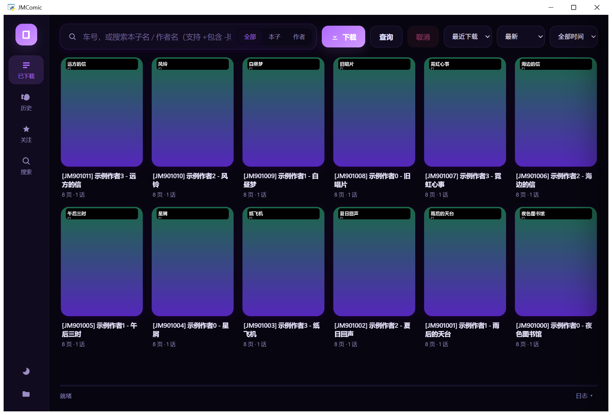
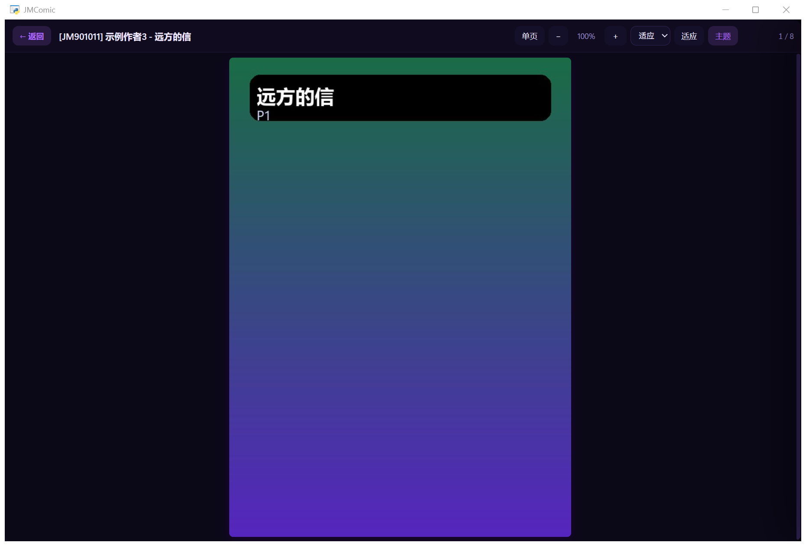
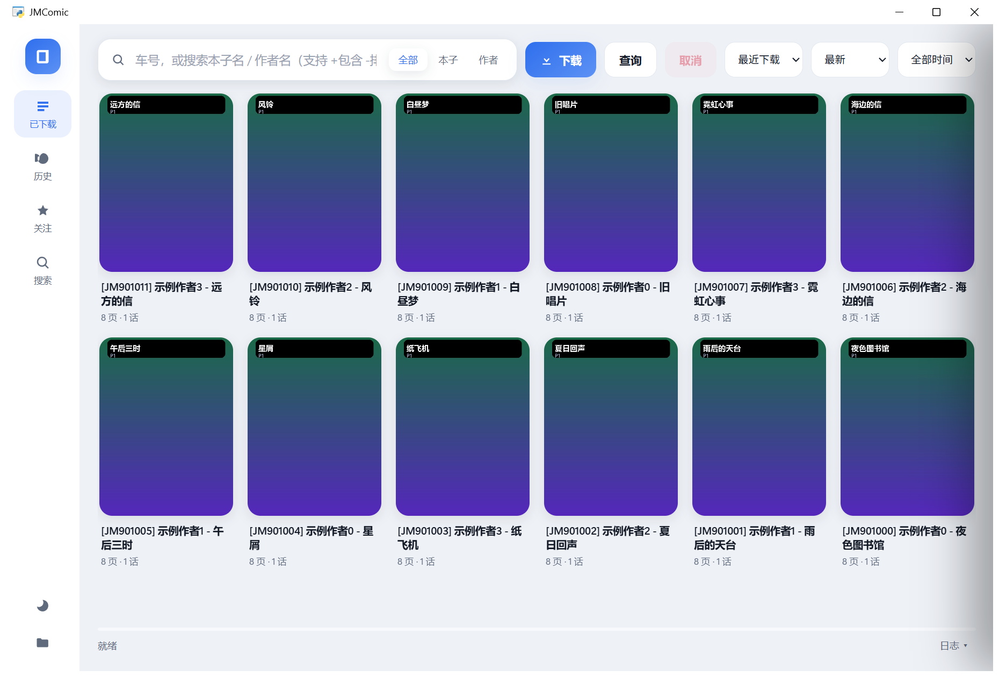
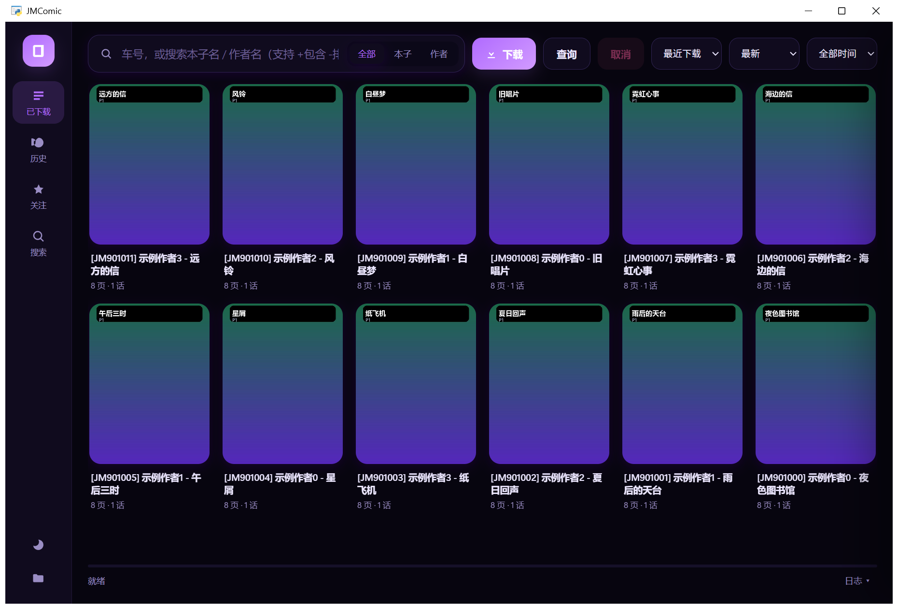

# JMComic 工具箱


> 一个自用的桌面漫画下载 / 阅读工具：**WebView2 界面 + Python 内核**，
> 支持批量下载、内置阅读器、追更关注、导出 PDF/ZIP。

<p align="left">
  
  
  
  
  
</p>

---

## 功能

- **批量下载**：输入车号 / 站内链接 / `p` 章节号 / 含车号的文字，自动提取并**排队串行下载**（已存在的图片自动跳过）
- **封面墙**：本地已下载库以卡片墙展示，支持实时筛选、按名称/页数/话数/作者排序、**未读优先**
- **内置阅读器**：单页 / **双页** / 滚动三种模式；适应 / 适应宽度 / 适应高度；**以鼠标为中心缩放**；记住每本阅读进度，双击卡片续读
- **追更关注**：关注**作者**，一键检查新作品，导航红点 + 启动自动检查提醒
- **导出**：单本 / 整库导出 **PDF** 或 **ZIP**
- **搜索**：站内搜索，支持官方排序（最新 / 最多观看 / 最多点赞 / 最多图片 / 最高评分 / 最多评论）与时间范围（全部 / 今天 / 本周 / 本月）
- **主题**：深色 / 浅色 / 霓虹 / 樱花 / 跟随系统
- **安全删除**：删除走 **回收站**（不直接抹盘），支持行内快捷删除
- **自用 QQ 机器人**（可选）：OneBot 11 反向 HTTP，仅私聊 + 白名单

> 想看每个功能的图文详解：[**FEATURES.md**](FEATURES.md)

## 截图

| 主界面 | 阅读器（双页） |
|---|---|
|  |  |

| 浅色主题 | 霓虹主题 |
|---|---|
|  |  |

> 截图使用自动生成的**演示书库**，不含真实内容。

## 架构

```
界面层   webui/{index.html, style.css, app.js}   跑在 WebView2 里（HTML/CSS/JS）
   ↕  window.pywebview.api.xxx()  /  evaluate_js
桥接层   webui/host.py                             转发调用、线程、错误包装、本地图片服务
   ↕  普通函数调用
核心层   src/jmapp.py                              下载 / 解析 / 搜索 / 导出 / 历史（不 import tkinter）
```

## 快速开始（源码运行）

```powershell
# 1) 装依赖
python -m pip install jmcomic pywebview pillow

# 2) 准备配置（复制模板后按需修改）
copy option.example.yml option.yml

# 3) 启动新界面
python webui\host.py
```

要求：Windows 10/11 + **WebView2 Runtime**（系统一般自带；缺失时到微软官网装 Evergreen Runtime）。

## 打包成单文件 exe

```powershell
powershell -ExecutionPolicy Bypass -File webui\build_web.ps1
# 产物：JMComicWeb.exe（约 28 MB，内嵌界面资源与图标）
```

`build_web.ps1` 里的关键参数：`--add-data "webui;webui"`、`--paths src`、
`--hidden-import webview.platforms.edgechromium|winforms|clr`、`--collect-all webview|pythonnet|clr_loader`。

## 配置：`option.yml`

| 字段 | 说明 |
|---|---|
| `dir_rule.base_dir` | 下载根目录（默认 `./downloads`） |
| `dir_rule.rule` | 目录/文件命名规则，例如 `Bd/[JM{Aid}] {Aauthor} - {Atitle}/{Pindex:03d}-{Pname}` |
| `download.threading` | 图片/章节并发数 |

图片文件默认命名为 `JM{车号}_{页码}`，便于多本共存时排序。

## 命令行版

```powershell
cli\jm.cmd 350234           # 下载一本
cli\jm.cmd --help
```

## 自用 QQ 机器人（可选）

见 [`bot/README-机器人.md`](bot/README-机器人.md)。复制 `bot/bot_config.example.yml` 为
`bot/bot_config.yml` 并填入你的 OneBot 实现地址与**你自己的** QQ 号白名单。

> 仅用于**自己**私聊使用；不含群聊分发逻辑。

## 目录结构

```
webui/            界面层（HTML/CSS/JS + 宿主）
src/jmapp.py      核心层（可单独 import 使用）
cli/              命令行封装
bot/              自用机器人（可选）
tools/            构建脚本（图标生成、打包）
docs/             迁移指南、执行说明书、图标说明
screenshots/      演示截图
```

## 文档

- [`docs/Tkinter转WebView2界面-迁移指南.md`](docs/Tkinter转WebView2界面-迁移指南.md) —— 把任意 Tkinter 程序改成 WebView2 界面的完整方法（含 12 个坑）
- [`docs/交给执行AI-任务说明书.md`](docs/交给执行AI-任务说明书.md) —— 交给另一个 AI 执行同类迁移时的约束与验收清单
- [`docs/图标说明-NOTICE.md`](docs/图标说明-NOTICE.md) —— 图标来源与使用边界

## 特别鸣谢

- **内核： [`jmcomic`](https://pypi.org/project/jmcomic/)（JMComic-Crawler-Python）— 作者 [hect0x7](https://github.com/hect0x7/JMComic-Crawler-Python)**
  本项目的下载、搜索、详情解析、图片 URL 解密等能力全部来自这个库；
  没有它就没有这个工具。请优先给上游项目点星支持。
- 界面桥接：[pywebview](https://pywebview.flowrl.com/) + [pythonnet](https://github.com/pythonnet/pythonnet)（WebView2 宿主）
- 打包：[PyInstaller](https://pyinstaller.org/)
- 图像处理：[Pillow](https://python-pillow.org/)

## 已知限制


- 仅 Windows（依赖 WebView2）
- 站点详情接口较慢，搜索结果卡片里的页数/话数是异步补全的（分批回填）
- 需要登录才能看的内容，请在 `option.yml` 或客户端的 cookie 配置中提供

## 免责声明

本项目为**个人自用**工具，仅用于下载用户自己有权访问的内容。请遵守所在地法律法规与站点服务条款；
请勿用于传播、贩卖或任何侵犯著作权的用途。项目作者不对使用者的行为承担责任。

## License

[MIT](LICENSE)
